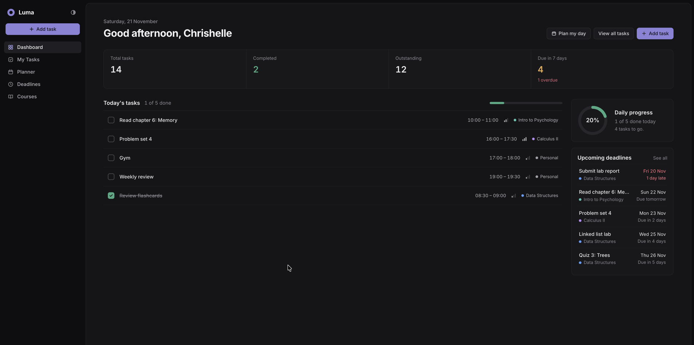
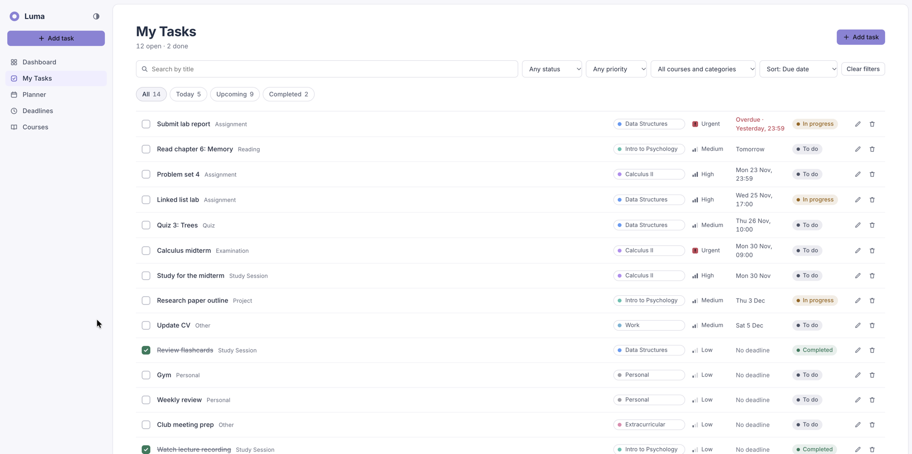
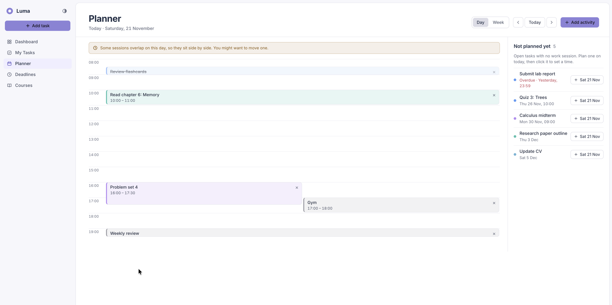
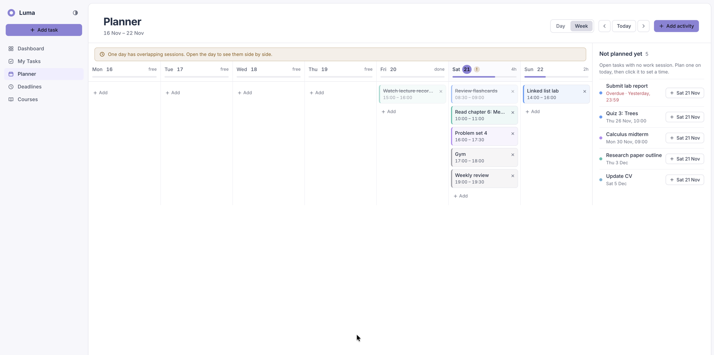
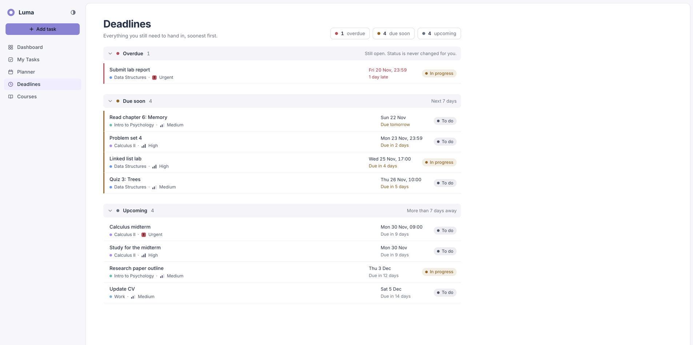
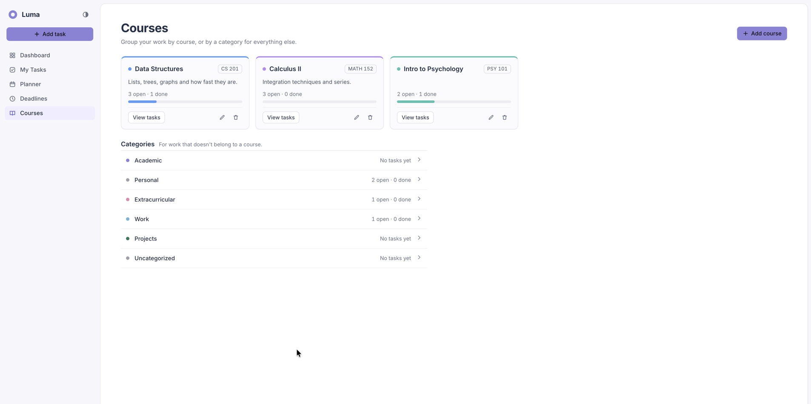
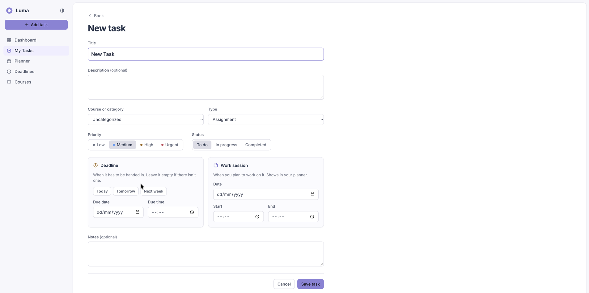
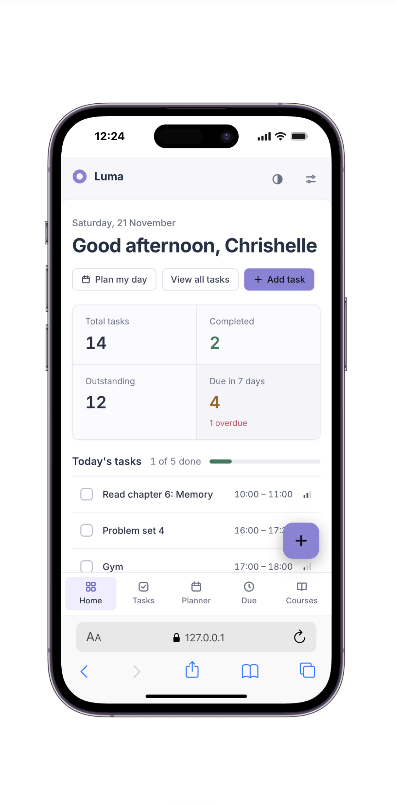
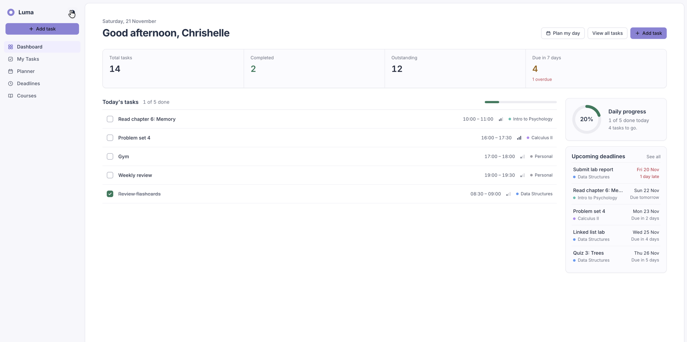

# Luma

**Your day, in focus.**

Luma is a simple planner for students. It keeps your tasks, deadlines and study time in one calm place, so you always know what to do next.

## Why I made Luma

Most planning apps are either too basic or too complicated. Apps like Notion can do almost anything, but setting them up takes time, and that time could be spent studying.

Luma is the middle ground. It's ready to use the moment you open it, and it looks good while doing its job.

## What you can do

### See your day at a glance
The **Dashboard** greets you by name and shows:
- how many tasks you have, how many are done and how many are left
- everything planned for today, with a box to tick each one off
- a progress ring that fills up as you go
- your next five deadlines

### Keep track of every task
**My Tasks** lists everything you need to do. Each task can have a course, a type (like assignment, quiz or exam), a priority from Low to Urgent, and a due date.

You can search by name, filter by course, priority or status, and sort the list however you like.

### Plan when you'll do the work
A deadline is when something is *due*. A work session is when you plan to *work on it*. Luma keeps these separate, so an essay due Friday can still be planned for Tuesday evening.

The **Planner** has two views:
- **Day:** a timeline of your day. Click any hour to plan something then.
- **Week:** all seven days side by side, so you can spot your busy and free days.

If two things overlap, Luma gently points it out. Tasks you haven't planned yet are listed on the side, ready to be given a time.

### Never miss a deadline
**Deadlines** sorts everything you still need to hand in into three groups:
- **Overdue:** the date has passed
- **Due soon:** due in the next seven days
- **Upcoming:** further away

### Organise by course
Add your courses with a name, a course code and a colour. Every task can belong to a course, so you can see each subject's work in one place. For everything else there are categories like Personal, Work and Extracurricular.

If you delete a course, its tasks aren't lost. They just move to "Uncategorized".

### Make it yours
In **Settings** you can:
- set the name Luma greets you with
- choose a dark or light look, or match your device
- start your week on Monday or Sunday
- save a backup of everything as a file, and bring it back later or on another computer
- load sample data to try Luma out
- clear everything and start fresh

Big changes can be undone with one click, straight after you make them.

## Works on your phone too

Luma fits any screen. On a phone, the menu moves to the bottom and a round **+** button lets you add a task from anywhere.

It also comes in a light theme:

## Your data stays with you

Luma has no accounts and no sign-up. Everything you add is saved in your own web browser, on your own device. Nothing is sent anywhere.

That also means your tasks don't move between devices on their own. To move them, use **Settings → Export** on one device and **Import** on the other.

## How to try it

1. Open Luma in your browser.
2. Want to see it full of examples first? Go to **Settings → Load sample data**.
3. Press **Add task** (or the **N** key) to add your first real task.

## Running it on your own computer

You'll need a copy of this project and a small local web server. Here are two easy options.

- **VS Code:** install the *Live Server* extension, open the project folder, right-click `index.html` and choose **Open with Live Server**.
- **Terminal (Mac):** open the project folder in Terminal, run `python3 -m http.server`, then visit `http://localhost:8000` in your browser.

Opening `index.html` by double-clicking it won't work, because browsers block some features for files opened that way.

## How it's built

Luma is built with the three basic building blocks of every website:
- **HTML** for the structure of each page
- **CSS** for the look: colours, spacing and layout
- **JavaScript** for everything that happens when you click, type or tick

There are no extra frameworks or libraries, and there's no server or database behind it. Your data is saved using a feature built into every browser called *Local Storage*. The font is [Inter](https://rsms.me/inter/).

## What's next

Ideas for future versions:
- reminders before a deadline
- installing Luma on your phone like a regular app
- adding your plans to your calendar app

## About

Luma was built by Chrishelle as a university project, to learn how real web apps are designed and put together.
